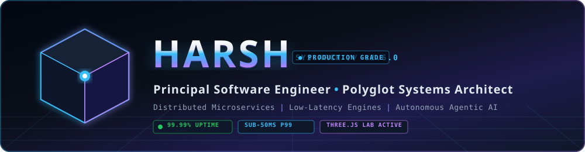
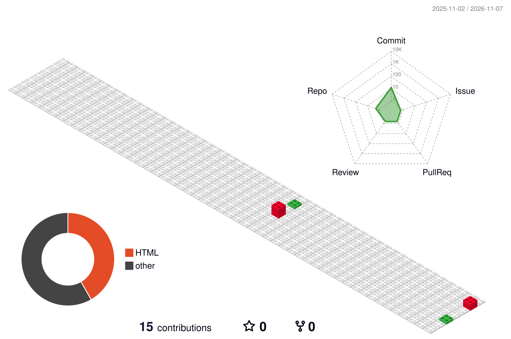
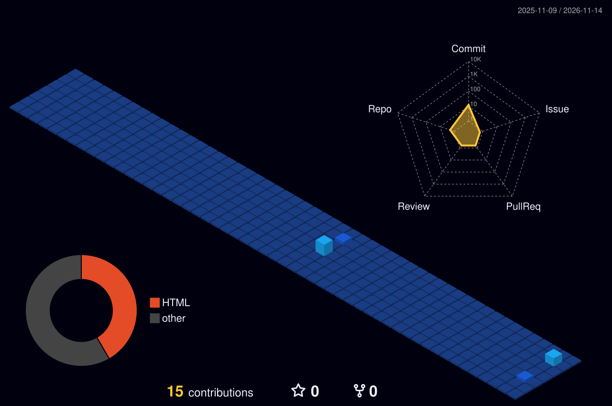

<div align="center">

<!-- 3D Bespoke Metallic & Neon Insignia -->
<a href="https://devils-programming.github.io/Devils-Programming/" target="_blank">
  
</a>

<!-- Dynamic Terminal-Style Subtitle -->
<a href="https://github.com/Devils-Programming">
  
</a>

<br/><br/>

<!-- Interactive 3D Three.js WebGL Launcher Card -->
<a href="https://devils-programming.github.io/Devils-Programming/" target="_blank">
  
</a>

<br/><br/>

<!-- Live Status & Telemetry Pill Badges -->
<p align="center">
  
  
  
  
</p>

<!-- Quick Navigation Bar -->
<p align="center">
  <a href="#-executive-system-brief"><b>[ 🏢 Executive Brief ]</b></a> •
  <a href="#%EF%B8%8F-3d-isometric-contribution-skyline"><b>[ 🏙️ 3D Skyline ]</b></a> •
  <a href="#-architectural-pillars--engineering-doctrine"><b>[ 🏛️ Pillars ]</b></a> •
  <a href="#-featured-systems-architecture"><b>[ 🚀 Systems ]</b></a> •
  <a href="#%EF%B8%8F-polyglot-tech-arsenal"><b>[ 🛠️ Tech Stack ]</b></a> •
  <a href="#-live-telemetry--holographic-metrics"><b>[ 📊 Telemetry ]</b></a> •
  <a href="#-connect--dispatch"><b>[ 📬 Contact ]</b></a>
</p>

</div>

---

### 💻 Executive System Brief

```bash
harsh@production-node:~$ neofetch --system-profile
```

```yaml
Operator       : Harsh | Systems Architect & Principal Builder
GitHub Handle  : Devils-Programming
Runtimes       : Rust, Go, Python 3.12, TypeScript 5.x, Java 21, C++20, Modern SQL
Core Paradigm  : Distributed Microservices, Event-Driven Streaming, Agentic AI, Zero-Trust
Availability   : Sub-50ms p99 Latency SLA • Zero-Downtime Blue/Green Deployments
Interactive Lab: https://devils-programming.github.io/Devils-Programming/
Mission        : Eliminating system drag, reducing operational overhead, building platforms that scale silently.
```

---

### 🏙️ 3D Isometric Contribution Skyline

<div align="center">
  <picture>
    <source media="(prefers-color-scheme: dark)" srcset="https://raw.githubusercontent.com/Devils-Programming/Devils-Programming/output/profile-night-rainbow.svg" />
    <source media="(prefers-color-scheme: light)" srcset="https://raw.githubusercontent.com/Devils-Programming/Devils-Programming/output/profile-season-animate.svg" />
    
  </picture>
</div>

<details>
  <summary><b>📐 Switch 3D Projection Perspective (Isometric Block City & Cyber Grid)</b></summary>
  <br/>

  <div align="center">
    <p><b>Perspective B: 3D Isometric Voxel Blocks (GitBlock Projection)</b></p>
    
    <br/><br/>
    <p><b>Perspective C: Deep Cyberpunk Night View</b></p>
    
  </div>
</details>

---

### 🏛️ Architectural Pillars & Engineering Doctrine

<table>
  <tr>
    <td width="50%" valign="top">
      <h4>🌐 Language-Agnostic Mastery</h4>
      <code>[TAG: HIGH-PERFORMANCE RUNTIMES]</code>
      <p>Select stacks based on memory footprint, execution speed, and concurrency primitives rather than hype. Ship verified production software across <b>Rust, Go, Python, TypeScript, Java, and C++</b>.</p>
    </td>
    <td width="50%" valign="top">
      <h4>🚀 End-to-End System Ownership</h4>
      <code>[TAG: ZERO-DOWNTIME DELIVERY]</code>
      <p>Drive systems through the entire lifecycle—from RFC architecture reviews and database schema topologies to automated CI/CD canary deployments and SLA monitoring.</p>
    </td>
  </tr>
  <tr>
    <td width="50%" valign="top">
      <h4>⚡ Extreme Throughput & Latency Tuning</h4>
      <code>[TAG: SUB-50MS P99 ARCHITECTURE]</code>
      <p>Fine-tune memory allocation, connection pools, and distributed caching hierarchies. Eliminate N+1 query overheads, apply lock-free algorithms, and ensure sub-second analytical aggregations.</p>
    </td>
    <td width="50%" valign="top">
      <h4>🤖 Agentic AI & Intelligent Pipelines</h4>
      <code>[TAG: PRODUCTION LLM WORKFLOWS]</code>
      <p>Engineer deterministic agentic workflows, function-calling orchestration engines, and high-dimensional vector search pipelines (pgvector/Pinecone) with strict safety evaluation gates.</p>
    </td>
  </tr>
  <tr>
    <td width="50%" valign="top">
      <h4>☁️ Cloud-Native & Chaos Resilience</h4>
      <code>[TAG: 99.99% HIGH-AVAILABILITY]</code>
      <p>Architect auto-scaling container mesh networks (Kubernetes, Docker), event-driven serverless architectures, circuit breakers, and idempotency keys to guarantee seamless disaster recovery.</p>
    </td>
    <td width="50%" valign="top">
      <h4>📈 Business-First Technical Execution</h4>
      <code>[TAG: ROI-DRIVEN ENGINEERING]</code>
      <p>Translate ambiguous enterprise challenges into measurable technical roadmaps. Bridge engineering decisions directly to business throughput, customer retention, and infrastructure cost optimization.</p>
    </td>
  </tr>
</table>

<details>
  <summary><b>🔍 Expand: The 5 Core System Design Commandments I Enforce</b></summary>
  <br/>
  <ol>
    <li><b>Idempotency Everywhere:</b> Every mutation, webhook consumer, and payment event must be safely replayable with zero side effects.</li>
    <li><b>Telemetry Before Optimization:</b> No premature tuning without distributed traces (OpenTelemetry), p95/p99 latency histograms, and saturated CPU/memory profiling.</li>
    <li><b>Defense in Depth:</b> Strict boundary validation, least-privilege RBAC, automated secret rotation, and sanitized SQL parameterized queries.</li>
    <li><b>Schema Evolution Discipline:</b> Non-destructive schema migrations only (Expand/Contract pattern) to guarantee zero lockups during rolling updates.</li>
    <li><b>Automate All Toil:</b> If a verification step must be run more than twice, it belongs codified as an automated GitHub Action or pre-commit hook.</li>
  </ol>
</details>

---

### 🚀 Featured Systems Architecture

<div align="center">

| System | Architecture Blueprint | Core Stack | Key Impact |
| :--- | :--- | :--- | :--- |
| **Distributed Event Streaming Engine** | Distributed event-driven message broker with consumer groups, WAL persistence, and partition sharding. | `Go` `Kafka` `Redis` `Docker` | **100k+ events/sec** with sub-10ms delivery latency |
| **Autonomous Multi-Agent AI Suite** | Multi-agent execution engine with dynamic tool execution, memory compaction, and structured JSON output. | `Python` `FastAPI` `LangGraph` `pgvector` | **70% reduction** in manual workflow operational toil |
| **High-Throughput Analytics Service** | Low-latency columnar OLAP query engine with tiered memory cache and real-time streaming ingestion. | `Rust` `ClickHouse` `PostgreSQL` `gRPC` | **Sub-50ms p99** query time across 50M+ rows |

</div>

---

### 🛠️ Polyglot Tech Arsenal

<div align="center">

<!-- Systems & Core Languages -->
<p><b>Systems, Application & Query Languages</b></p>


<br/><br/>

<!-- Backend, Frameworks & Data Engines -->
<p><b>Distributed Backend, Messaging & Storage Engines</b></p>


<br/><br/>

<!-- Cloud, DevOps & Orchestration -->
<p><b>Cloud Infrastructure, Containers & CI/CD</b></p>


<br/><br/>

<!-- AI, Tooling & Frontend Ecosystem -->
<p><b>AI/ML, Native Platforms & Modern Interfaces</b></p>


</div>

---

### 📊 Live Telemetry & Holographic Metrics

<div align="center">

<!-- GitHub Trophies Holographic Grid -->


<br/><br/>

<!-- Side-by-Side Live Performance Cards -->
<table border="0">
  <tr>
    <td align="center">
      <a href="https://github.com/Devils-Programming">
        
      </a>
    </td>
    <td align="center">
      <a href="https://github.com/Devils-Programming">
        
      </a>
    </td>
  </tr>
</table>

<br/>

<!-- Dynamic Neon Activity Graph -->


</div>

---

### 🐍 Contribution Activity Matrix

<div align="center">
  <picture>
    <source media="(prefers-color-scheme: dark)" srcset="https://raw.githubusercontent.com/Devils-Programming/Devils-Programming/output/github-snake-dark.svg" />
    <source media="(prefers-color-scheme: light)" srcset="https://raw.githubusercontent.com/Devils-Programming/Devils-Programming/output/github-snake.svg" />
    
  </picture>
</div>

---

### 📬 Connect & Dispatch

<div align="center">

<p>Whether you're looking to discuss high-scale distributed systems, explore custom agentic AI implementations, or collaborate on open-source initiatives—feel free to reach out.</p>

<p align="center">
  <a href="https://linkedin.com/in/" target="_blank">
    
  </a>
  <a href="mailto:your.email@example.com">
    
  </a>
  <a href="https://github.com/Devils-Programming?tab=repositories">
    
  </a>
  <a href="https://github.com/Devils-Programming?tab=followers">
    
  </a>
</p>

<!-- Animated 3D Cyber Wave Footer -->


<sub>Designed with high precision • Built for resilience • Scaled without friction</sub>

</div>
