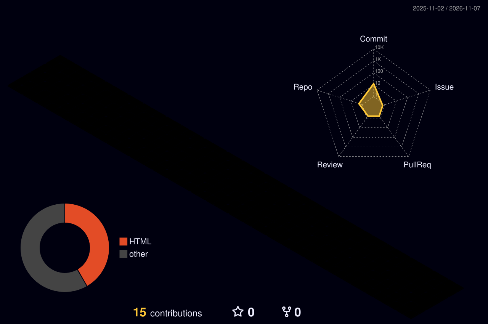

<!-- 3D Animated Hero Header -->

<!-- Dynamic Typing Subtitle -->

  

<!-- Social & Telemetry Badges -->

  
  
  
  

---

### ⚡ Executive Overview

> **Seasoned Software Engineer with 3–5+ years of experience** delivering fault-tolerant, scalable software across diverse technology stacks—bridging deep multi-language engineering with direct business impact.

---

### 🏙️ 3D Contribution Skyline

  <picture>
    <source media="(prefers-color-scheme: dark)" srcset="https://raw.githubusercontent.com/Devils-Programming/Devils-Programming/output/profile-night-rainbow.svg" />
    <source media="(prefers-color-scheme: light)" srcset="https://raw.githubusercontent.com/Devils-Programming/Devils-Programming/output/profile-season-animate.svg" />
    
  </picture>

---

### 🏛️ Engineering Architecture & Core Pillars

<table>
  <tr>
    <td width="50%" valign="top">
      <h4>🌐 Language-Agnostic Engineering</h4>
      
Deploy production-grade code across <b>Python, TypeScript, Go, Java, C++, Rust, and SQL</b>—choosing stacks for efficiency and resilience rather than hype.

    </td>
    <td width="50%" valign="top">
      <h4>🚀 End-to-End Ownership</h4>
      
Drive software systems from initial architectural design to <b>zero-downtime release</b> across full-stack web, cross-platform mobile, and backend microservices.

    </td>
  </tr>
  <tr>
    <td width="50%" valign="top">
      <h4>⚡ Performance & Scalability</h4>
      
Tune database schemas, minimize API latency, and scale throughput while enforcing strict security, comprehensive test coverage, and modular codebases.

    </td>
    <td width="50%" valign="top">
      <h4>🤖 AI, Data & Automation</h4>
      
Implement agentic workflows, production <b>LLM pipelines</b>, and automated data transformations that remove operational drag and accelerate shipping cadence.

    </td>
  </tr>
  <tr>
    <td width="50%" valign="top">
      <h4>☁️ Cloud-Native Execution</h4>
      
Orchestrate containerized deployments, serverless functions, and automated <b>CI/CD pipelines</b> configured for continuous validation and maximum uptime.

    </td>
    <td width="50%" valign="top">
      <h4>📈 Business-First Mindset</h4>
      
Convert product specifications into actionable technical milestones, partnering closely with design, operations, and leadership to hit business goals.

    </td>
  </tr>
</table>

  
<b>🔍 Click to expand Architectural Principles & Engineering Standards</b>

   
  <ul>
    <li><b>Resilience by Default:</b> Idempotent APIs, circuit breakers, structured tracing, and graceful degradation under traffic surges.</li>
    <li><b>Database Discipline:</b> Index-first query design, connection pooling, row-level safety, and backward-compatible schema migrations.</li>
    <li><b>Zero-Toil Automation:</b> Static analysis, security scanning, container builds, and deployment verification run entirely in CI/CD.</li>
  </ul>

---

### 🛠️ Polyglot Tech Stack

| Domain | Technologies & Tooling |
| :--- | :--- |
| **Languages** |  |
| **Backend & Microservices** |  |
| **Frontend & Mobile** |  |
| **Cloud & DevOps** |  |

---

### 📊 Live Telemetry & Engineering Metrics

  <!-- GitHub Trophies -->
  

    

  <!-- Stats & Streak Side-by-Side -->
  
  

    

  <!-- Glowing Activity Graph -->
  

---

### 🐍 Contribution Activity Matrix

  <picture>
    <source media="(prefers-color-scheme: dark)" srcset="https://raw.githubusercontent.com/Devils-Programming/Devils-Programming/output/github-snake-dark.svg" />
    <source media="(prefers-color-scheme: light)" srcset="https://raw.githubusercontent.com/Devils-Programming/Devils-Programming/output/github-snake.svg" />
    
  </picture>

<!-- Animated Wave Footer -->

